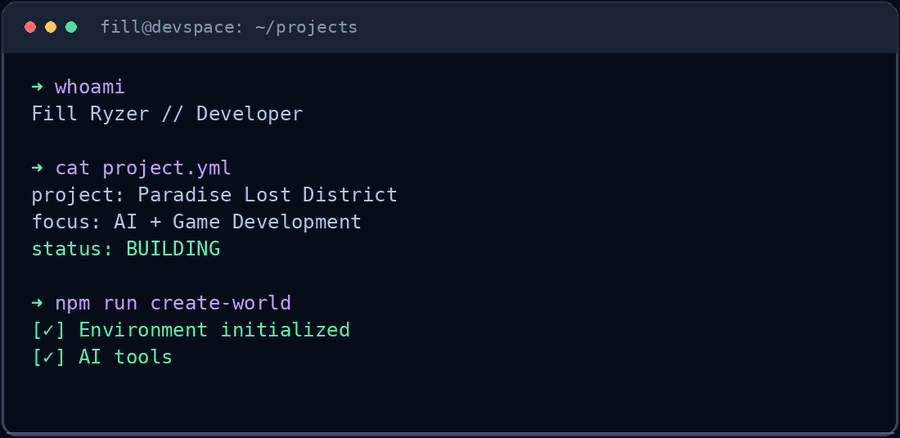

 

## 👋 About Me

Hey, I'm **Fill Ryzer** — collaborating on the development of **Paradise Lost District** and exploring AI-assisted game creation.

## ⌘ Developer Console

## ⚡ Development Universe

| 🎮 Game Development | 🧠 AI Collaboration | 💻 Creative Coding |
|:---:|:---:|:---:|
| Interactive worlds & gameplay systems | Intelligent tools & workflows | Ideas turned into digital experiences |

## 🌆 Featured Project

### PARADISE LOST DISTRICT

**MULTIPLAYER · OPEN WORLD · SOCIAL RPG**

An indie multiplayer open-world social RPG built through collaboration, creative experimentation and modern development workflows.

🌍 Development updates are primarily in Russian. International visitors are welcome.

## 📊 GitHub Activity

---

### 🌐 Connect & Collaborate

 

**`CODE. CREATE. EVOLVE.`**

